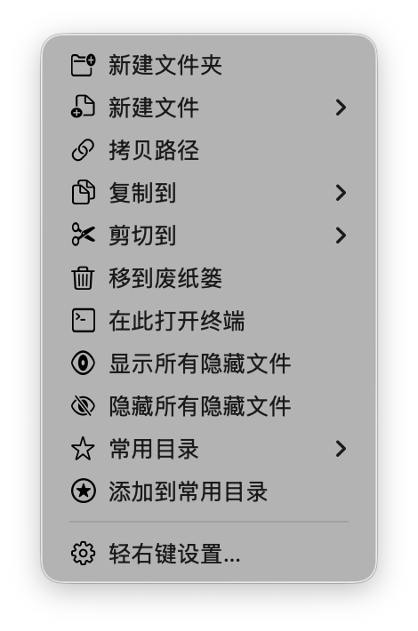

# 轻右键 · QingYouJian

一个本机运行的 macOS Finder 小工具。设置界面用 Vue + Tauri，Finder 右键入口使用最小 Objective-C 扩展。

## 第一版功能

- **新建文件夹**：输入名称，同名自动编号，创建后在 Finder 中选中。
- **新建文件**：TXT、Markdown、JSON、XML、Shell、Word、Excel 和自定义文件名。Word / Excel 使用真实空白模板，不是改后缀的空文件。
- **拷贝路径**：文件、文件夹或当前目录；多选每行一个绝对路径。
- **在此打开终端**：使用系统 Terminal，进入目标目录。
- **显示 / 隐藏隐藏文件**：一个菜单项直接触发 Finder 自带的 ⌘⇧. 切换，即时刷新、不重启 Finder、不改变文件隐藏属性；首次需辅助功能授权。
- **移到废纸篓**：仅操作选中项，使用系统废纸篓，可恢复。
- **复制到 / 剪切到**：从常用目录选择目标，或选择其他目录；同名自动编号，不覆盖，支持多选。
- **ZIP 压缩与解压**：单项或多选合并 ZIP，支持解压到当前目录或按包名建立独立目录；同名自动编号，不覆盖、不删除源包，完成后在 Finder 中选中。
- **菜单小图标**：Finder 主菜单和子菜单均显示对应操作或文档类型图标。
- **常用目录**：右键添加、快速打开；设置中可改名、排序、重新定位和移除。

设置内提供“显示菜单栏图标”“随系统启动”“关闭设置后在后台静默运行”三个开关，默认分别为关闭、关闭、开启。登录项实际授权状态由 macOS 管理。

不需要账号、订阅或联网服务，不收集使用数据。关闭设置窗口会销毁 WebView；默认保留轻量宿主，也可关闭后台驻留，右键操作仍可按需启动。

ZIP 当前支持普通文件/目录、中文名称、空目录及 Store/Deflate 压缩；加密 ZIP、符号链接、特殊文件和其他格式暂不支持，macOS 扩展属性/资源叉/修改时间还原暂不保证。目录内同名根项目整体编号，不合并已有目录。ZIP 操作不需要辅助功能权限。

## 系统与发行状态

目标为 macOS 13+，首轮构建为 Apple Silicon。未经验证的旧系统、Intel 和云盘目录不能据此推断兼容。

当前版本为本机自用的 `0.1.0` 预览版，使用 ad-hoc 签名，未做 Apple Developer ID 公证。源码构建不需要付费开发者账号。具体检查结果和未验证项见 [验证记录](docs/VALIDATION.md)。



上图由实际扩展菜单代码在测试进程中渲染，不是 Finder 鼠标操作验收截图。

## 从源码构建

开发工具：Xcode Command Line Tools、Node.js（见 `.nvmrc`）、Rust（见 `rust-toolchain.toml`）。用户运行发布包时不需要 Node.js 或数据库服务。

```bash
npm ci
npm run build:macos
```

输出：`src-tauri/target/release/bundle/macos/轻右键.app`。构建命令不会安装、启用扩展或重启 Finder。

本机安装（明确运行此脚本才会复制和注册扩展）：

```bash
bash scripts/install-local.sh
```

也可将构建好的应用移到应用程序目录，打开一次，再到“系统设置 → 通用 → 登录项与扩展 → Finder 扩展”启用轻右键。系统版本不同，设置项位置可能不同。菜单不出现时先检查扩展是否启用；不要关闭 SIP。

## 使用规则

| 右键位置 | 创建 / 终端 / 添加收藏的位置 |
| --- | --- |
| 空白处 | 当前目录 |
| 一个文件夹 | 该文件夹内部 |
| 一个文件或应用包 | 所在目录 |
| 多选 | 当前浏览目录 |

常用目录存放的是路径引用；移动目录后需重新定位。移除收藏不会删除目录。部分云盘位置不会展示第三方 Finder 菜单，第一版优先本地目录。

## 检查命令

```bash
npm run typecheck
npm run lint
npm run test -- --run
cargo fmt --manifest-path src-tauri/Cargo.toml --check
cargo clippy --manifest-path src-tauri/Cargo.toml --all-targets -- -D warnings
cargo test --manifest-path src-tauri/Cargo.toml
bash scripts/test-native.sh
```

前端可单独运行 `npm run dev` 预览；浏览器预览不会模拟本机操作。Finder 手工测试及签名/跨进程验证独立于上述逻辑测试。

## 数据与卸载

本机 SQLite：`~/Library/Application Support/local.qingyoujian/qingyoujian.sqlite3`。Finder 扩展只读取菜单快照，不直接写入数据库。

卸载前退出轻右键，在系统设置中关闭其 Finder 扩展，移除应用即可。配置默认保留；如果确定不再需要，可自行删除上述应用数据目录。用户文件不受影响，Finder 隐藏显示偏好不会在卸载时被修改。

## 项目文档

[产品需求](docs/PRD.md) · [系统架构](docs/ARCHITECTURE.md) · [本地存储](docs/DB_DESIGN.md) · [开发计划](docs/PLAN.md) · [协作规则](AGENTS.md)

## 开源声明

MIT。部分集成机制和图标参考 [nikgrbn/finder-menu](https://github.com/nikgrbn/finder-menu)，保留原作者声明。详见 [THIRD_PARTY_NOTICES.md](THIRD_PARTY_NOTICES.md)。
