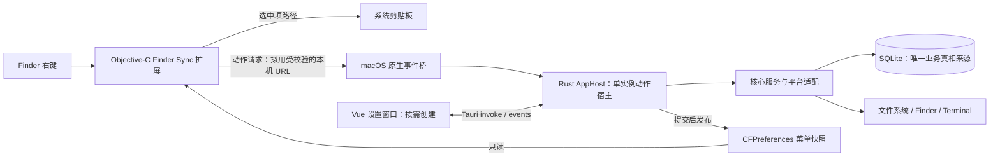

# 轻右键系统架构

版本：1.1；起草于 2026-11-14，2026-11-15 开始实现。当前检查与未验证项见 VALIDATION.md；设计说明不替代运行证据。

## 1. 技术决策

| 层次 | 选型 | 理由与边界 |
| --- | --- | --- |
| 设置界面 | Vue 3 + TypeScript + Vite | 用前端技术实现设置、收藏和类型配置；仅开发期使用 Node.js |
| 桌面宿主 | Tauri 2 + Rust | 使用系统 WebView；承载本机操作与生命周期 |
| Finder 入口 | Objective-C + Finder Sync | 仅实现 macOS 必需的扩展与桥接，不继续全 Swift 应用路线 |
| 本机存储 | SQLite，Rust rusqlite 访问 | 嵌入式、无外部服务；按事务管理收藏和设置 |
| 扩展只读配置 | CFPreferences 单键菜单快照 | 避免扩展打开数据库或扫描目录；读取权限需 M0 验证 |
| 前端验证 | vue-tsc、ESLint、Vitest | 类型、规则及有价值的组件/逻辑测试 |
| Rust 验证 | cargo fmt / clippy / test | 格式、静态检查、文件与存储行为测试 |
| 打包 | macOS .app，后续 .dmg | Finder .appex 单独编译、嵌入、由内到外签名 |

Node、Rust 和依赖版本已记录于 .nvmrc、rust-toolchain.toml、package-lock.json 和 Cargo.lock。SQLite 使用 bundled 构建避免依赖用户单独安装数据库。

不选 Electron：本工具只有少量设置界面，不值得为其携带完整 Chromium。Wails 保留为评估备选，不并行维护两套实现。跨平台范围是界面与通用业务逻辑；Finder 入口和系统设置不跨平台。

## 2. 逻辑架构



### 2.1 进程与生命周期

- Finder 扩展由系统加载，负责当前上下文、菜单和路径复制，不加载 WebView、不写数据库。
- AppHost 负责写入、系统调用、收藏和配置。设置窗口与动作处理共用 Rust 服务，不把业务规则重复放在 Vue 或 Objective-C。
- AppHost 通过 macOS LaunchServices 应用实例机制统一处理请求；直接打开应用显示设置，扩展请求仅执行动作。
- 设置窗口不配置为自动创建。动作冷启动必须证明不会闪出设置页或创建隐藏 WebView；关闭设置窗口时销毁 WebView。
- 当前选择保留不含 WebView 的轻量宿主。MVP 不额外引入 LaunchAgent、后台轮询服务或本地 HTTP 服务。
- 文件命名与失效收藏提示优先复用按需的原生小对话框，避免为单个动作启动整个设置界面。相关桥接属于 macOS 模块。

### 2.2 当前与目标目录

```text
finder-tools/
├── AGENTS.md
├── docs/                       # PRD、架构、存储、计划（当前已建立）
├── src/                        # 当前 Vue 设置窗口
│   ├── App.vue                 # 布局、导航和全局提示
│   ├── views/                  # 通用设置、常用目录、关于
│   ├── components/             # 侧栏、启动/菜单偏好、共享开关
│   ├── composables/            # 窗口级状态、动作锁和事件清理
│   └── services/desktop.ts     # 类型化 Tauri 命令和订阅入口
├── src-tauri/                  # 目标：Tauri + Rust
│   ├── src/commands/           # Vue 命令入口
│   ├── src/domain/             # 上下文、文件、收藏、设置服务
│   │   └── archive/            # ZIP 打包、临时解压、批次反馈和测试
│   ├── src/archive_actions.rs  # ZIP 后台任务与主线程反馈
│   ├── src/storage/            # SQLite、迁移和快照发布
│   ├── src/platform/macos/     # Finder、终端、原生事件与对话框桥接
│   ├── migrations/            # 版本化 DDL
│   ├── capabilities/          # 最小窗口权限
│   └── tests/                 # 核心集成测试
├── native/finder-extension/    # 目标：Objective-C 扩展、plist、entitlements
├── scripts/                   # 目标脚本与当前遗留脚本，须明确命名
├── tests/manual/               # 目标：Finder 手工验收记录
├── Sources/ Resources/ Tests/  # 当前上游 Swift 参考与未完成草稿
└── LICENSE                    # 保留上游 MIT 声明
```

Vue、Rust、native 与迁移目录已建立。不得将旧 `scripts/build.sh` 的成功视作 Tauri 构建成功。现有 Swift 草稿不进入新发布产物，也不在本次文档工作中删除。

### 2.3 设置窗口内部职责

App.vue 创建一次 useAppState 并通过 Vue provide/inject 交给页面，共用后端快照、动作锁与提示；挂载时读取配置并监听 settings_changed，卸载时释放监听。页面导航不会重复订阅，不引入全局状态库或后台轮询。

GeneralView 负责克隆设置并提交，启动与菜单偏好交给独立展示组件；SettingSwitch 使用已保存值控制选中状态，保存失败不会假装已生效。FavoritesView 负责收藏草稿和操作编排，改名失败保留草稿，后端仍负责目录校验和持久化。AboutView 负责产品信息和退出入口。所有原生命令名、参数和返回值集中在 services/desktop.ts，页面不直接调用 invoke。

## 3. 模块划分

| 模块 | 职责 | 不负责 |
| --- | --- | --- |
| FinderExtension | 菜单快照解析、上下文获取、剪贴板、动作转交 | 持久化写入、文件扫描、WebView |
| AppHost / ActionRouter | 生命周期、来源校验后的动作分发、统一错误返回 | 界面排版、直接拼 SQL |
| ContextResolver | 按 PRD 解析选中项、当前目录与包文件 | 猜测虚拟目录的物理位置 |
| FileService | 文件名、类型初始内容、编号创建、选中结果 | Office 伪文件、执行脚本 |
| FileActionService | 选中项复制、移动、系统废纸篓、同名编号和批次结果 | 永久删除、覆盖文件、自定义失败删除回退 |
| FavoriteService | 添加、打开、排序、改名、重新定位、移除 | 自动搜索失效目录 |
| SettingsService | 菜单设置、终端选择、内置文件类型 | 读取操作系统设置的缓存替代品 |
| Storage / SnapshotPublisher | 事务、迁移、投影发布 | 直接访问用户文件 |
| MacOSAdapter | Terminal、Finder、隐藏显示、系统对话框 | 通用收藏业务规则 |
| SettingsUI | 数据展示、交互反馈和目录选择 | SQL、任意命令执行、独立业务真相 |

## 4. 核心调用流程

### 4.1 新建文件

Finder 菜单选择类型 → 扩展发送类型 ID 与 Finder 上下文 → 宿主校验来源 → ContextResolver 决定目录 → 原生命名框 → FileService 查内置类型与内容 → 排他创建、不覆盖 → Finder 选中新文件。失败给出具体错误，取消无写入。

### 4.2 常用目录

添加：扩展传上下文 → FavoriteService 标准化路径并检查目录 → SQLite 事务写入或返回已存在 → 重建菜单快照 → 下次右键显示。

打开：扩展传收藏 ID → 宿主按 ID 读取最新路径 → 检查目录 → Finder 打开。失效时弹出取消、重新定位、移除；移除只改数据库。不能把菜单里的旧路径当作最新数据。

设置改名、排序、移除采用同一服务和发布流程。数据库提交成功但快照发布失败时，界面明确提示“已保存，菜单尚未刷新”，允许重发；宿主下次启动也从数据库重建快照，不回滚已成功保存的数据。

### 4.3 隐藏文件与终端

隐藏显示使用 Finder 原生 ⌘⇧. 快捷键，通过 CGEventPostToPid 定向发送给 Finder，先激活 Finder，立即刷新且不重启进程。Finder 快捷键改变的实时显示状态与磁盘 AppleShowAllFiles 值可能不一致，因此只提供一个切换菜单，不读写该偏好或缓存显示布尔值。缺少辅助功能权限时仅展示用途及系统授权入口，取消不发送事件；授权后可直接使用。启动和安装不执行切换。

Terminal 通过平台 API 或固定可执行程序的独立参数启动。目录不拼接成 Shell 命令；路径含空格、引号或中文应保持原值。验证 `pwd` 后才算完成。

## 5. 接口契约

以下是当前接口契约，已建立命令入口。前端命令统一 snake_case；JSON 字段统一 camelCase；时间为 UTC Unix 毫秒。

### 5.1 Vue → Rust

成功直接返回数据，失败通过 Tauri reject 返回 `AppError`；不再叠加一层 HTTP 状态码。

| 命令 | 入参 | 成功返回 |
| --- | --- | --- |
| `get_app_state` | 无 | 版本、扩展状态 enabled/disabled/unknown、设置、文件类型、收藏列表 |
| `get_settings` | 无 | `AppSettings` |
| `update_settings` | `{patch: AppSettings}`，完整终端与菜单配置 | 更新后的 `AppSettings` |
| `list_favorites` | 无 | 按顺序排列的 `Favorite[]` |
| `add_favorite` | `{path, displayName?}` | `{favorite, created: boolean}` |
| `rename_favorite` | `{id, displayName}` | `Favorite` |
| `reorder_favorites` | `{ids: string[]}`，完整且无重复 | 排序后的 `Favorite[]` |
| `relocate_favorite` | `{id, path}` | `Favorite`；冲突时返回 ALREADY_EXISTS |
| `remove_favorite` | `{id}` | `null` |
| `open_favorite` | `{id}` | `null` 或失效错误，UI 引导处理 |
| `list_file_types` | 无 | `FileType[]` |
| `open_extension_settings` | 无 | `null`；仅打开设置，不伪报已启用 |
| `refresh_menu_snapshot` | 无 | `{revision}` |
| `choose_directory` | 无 | 用户所选目录路径或 null |
| `open_login_settings` | 无 | 打开 macOS 登录项授权页面 |
| `quit_app` | 无 | 退出轻量宿主 |

`Favorite` 字段见 DB 文档；`AppSettings` 包含终端和菜单配置。MVP 不暴露通用 SQL、通用 Shell 或无限制文件系统调用给前端。目录选择通过受控的目录选择对话框完成。

### 5.2 Finder 扩展 → 宿主

协议版本 `1`，每次动作包含 UUID `requestId`、动作、上下文及可选资源 ID。

```json
{
  "protocolVersion": 1,
  "requestId": "example-uuid",
  "action": "new_file",
  "context": {
    "menuKind": "container",
    "targetedPath": "/Users/example/Downloads",
    "selectedPaths": []
  },
  "resourceId": "builtin-txt"
}
```

| 动作 | 资源 ID | 上下文 |
| --- | --- | --- |
| `new_folder` | null | 必需 |
| `new_file` | 文件类型 ID；自定义项为 null | 必需 |
| `open_terminal` | null | 必需 |
| `toggle_hidden` | null | 不需要 |
| `add_favorite` | null | 必需 |
| `open_favorite` | 收藏 ID | 不需要 |
| `show_settings` | null | 不需要 |
| `copy_items` / `move_items` | 目标收藏 ID；null 表示用户选其他目录 | 必须有 selectedPaths |
| `trash_items` | null | 必须有 selectedPaths |
| `compress_zip` | null | items + 非空 selectedPaths，合并所选项 |
| `extract_zip_here` / `extract_zip_folder` | null | items + 非空 selectedPaths，逐包解压 |

复制/移动/废纸篓由 Rust 后台工作线程调用 Foundation 文件 API；完成回到主线程反馈，数据库锁不跨越系统对话框或文件复制过程。菜单图标由扩展转换为固定 16pt 位图，不能把多尺寸原始图标直接交给 Finder。

拷贝路径在扩展内完成，不经过动作宿主。`menuKind` 仅允许 `container` / `items`；无法确定物理目录时 `targetedPath` 为 null，由统一规则判定可执行性。

拟采用 `qingyoujian://action?payload=<base64url(JSON)>`，由系统启动宿主，不启动本地 HTTP 服务。编码只用于传输，不代表认证。原生桥必须在收到 Apple Event 时校验发送者为本应用内已签名扩展，再传给 Rust；普通网页/外部应用不能通过 URL 执行文件写入或启动终端。菜单 ID 在宿主重新查表，不信任请求中的任意模板内容或可执行程序。

**M0 门槛：**验证事件发送者审计信息能否穿过 Tauri 启动与重开流程、可否校验嵌入扩展签名、冷启动是否无 WebView、LaunchServices 是否向同一宿主转交请求。未通过则记录原因，另行评估 XPC 等本机通信；不能退化为不校验来源的公开动作 URL。此处不是已具备的 Tauri 插件能力。

### 5.2.1 ZIP 模块（2026-11-20）

`archive_actions::start` 只负责校验选择、增加活动任务计数、启动工作线程与回到 AppKit 主线程反馈/选中结果。`domain/archive` 负责批次结果；`pack.rs` 使用 zip 9.8.0 的 ZipWriter + walkdir 流式读取普通文件和目录，`extract.rs` 使用同一库的 ZipArchive 流式解压。启用 Deflate 的 Rust 后端，关闭无关压缩和加密默认特性；不依赖外部 zip/unzip 命令、不拼接 shell。依赖接口按 Context7 和已锁定版本源码核对。

压缩写入同一父目录下的 NamedTempFile，finish 成功后 persist_noclobber 按名称编号发布。解压使用同一卷上的自有临时目录，校验每项 enclosed_name、普通文件类型和 CRC，文件用 create_new 写入；拒绝越界、链接和重复目标。权限仅恢复 0777 范围，不恢复 setuid/setgid 等位。全部内容读取成功后，通过 Foundation 移动 API 将根项目放到目标位置；复用文件操作的同名编号规则，目录不合并；独立目录整体移动。失败自动清理未发布暂存内容，批量不同包继续处理。

无数据库锁跨越 ZIP I/O，活动任务计数沿用宿主生命周期，非驻留模式等待任务结束才退出；不新增 WebView、轮询服务或通用脚本执行能力。

### 5.3 快照与事件

CFPreferences 域拟为 `local.qingyoujian`，键 `MenuSnapshot` 保存一个完整的 JSON 字符串；扩展仅申请该域只读权限。

```json
{
  "schemaVersion": 1,
  "revision": 1,
  "menuItems": [{"id": "new-file", "enabled": true, "sortOrder": 0}],
  "fileTypes": [{"id": "builtin-txt", "displayName": "TXT", "extension": "txt"}],
  "favorites": [{"id": "example-uuid", "displayName": "工作", "path": "/Users/example/Work"}]
}
```

每次菜单构建读一次快照；不为收藏逐项访问磁盘。快照缺失或版本不支持时保留“打开轻右键设置…”入口，引导初始化。扩展权限与偏好读取须先通过 M0，不默认要求付费团队的 App Group。

设置 UI 订阅 `settings_changed`（`{revision}`）并重读相应列表；后台动作产生的错误通过原生提示反馈。快照是数据库投影，不能作为反向写回数据库的来源。

### 5.4 统一错误

`AppError = {code: string, message: string, requestId?: string}`。至少区分 `INVALID_ARGUMENT`、`CONTEXT_UNAVAILABLE`、`NOT_FOUND`、`PERMISSION_DENIED`、`ALREADY_EXISTS`、`APP_UNAVAILABLE`、`STORAGE_ERROR`、`SNAPSHOT_PUBLISH_FAILED`、`UNSUPPORTED_PROTOCOL`、`UNTRUSTED_CALLER`、`OS_OPERATION_FAILED`。取消返回独立取消结果，不弹失败提示。界面显示可理解的中文，不泄露内部堆栈。

## 6. 存储、权限与部署

SQLite 是唯一持久化真相来源，只有 Rust 服务访问。详见 [DB_DESIGN.md](DB_DESIGN.md)。业务数据不放应用包、源码目录或下载目录。

Finder 扩展运行在沙箱内。宿主为本机自用发行，不默认启用 App Store 沙箱；系统隐私权限仍然生效。Tauri 只加载内置前端资源，权限按 commands 和窗口能力声明，不开放任意 Shell。

`.appex` 嵌入 `.app/Contents/PlugIns/`。构建需单独编译 Objective-C、拷贝资源、签名扩展后签名外层应用、校验签名、注册扩展并检查实际加载。Tauri 支持附加包内文件，不代表自动完成这些步骤。本地自用签名先验证；公开分发的 Developer ID、公证和账号成本在后续发行需求中决定。

日志仅记录动作 ID、错误类别和耗时，路径不写入默认日志。保留 [上游 MIT 来源](https://github.com/nikgrbn/finder-menu) 与本地 LICENSE，不沿用上游发布标识。

## 7. 验证与依据

先完成 M0 技术验证，再建立正式工程。测试拆为：Rust 逻辑/SQLite 集成、前端交互、扩展打包与注册、真实 Finder 操作及资源测量。WebView 测试或编译成功都不能替代 Finder 验收。

官方依据（查阅于 2026-11-14）：[Tauri 架构](https://v2.tauri.app/concept/architecture/)、[macOS 打包](https://v2.tauri.app/distribute/macos-application-bundle/)、[单实例](https://v2.tauri.app/plugin/single-instance/)、[配置与窗口](https://v2.tauri.app/reference/config/)、[Apple Finder Sync](https://developer.apple.com/library/archive/documentation/General/Conceptual/ExtensibilityPG/Finder.html)、[SQLite 适用场景](https://www.sqlite.org/whentouse.html)。

## 8. 启动、菜单栏与后台策略补充

使用原生 NSStatusItem 显示可选菜单栏图标，避免为菜单栏常驻一个 WebView。图标默认关闭，可打开设置和显式退出。

随系统启动使用 macOS 13+ 的 SMAppService.mainAppService 注册主应用，不额外创建 LaunchAgent。注册只由设置动作触发；实际授权状态来自系统，数据库保存用户期望值。注册失败不回退到修改其他启动机制。

后台默认开启。关闭设置销毁 WebView、隐藏 Dock；关闭后台选项后在无设置窗口且动作已完成时退出。活动动作计数只服务于这项生命周期策略，避免关闭窗口中断后台文件操作。显式退出不受此策略限制。

默认手动启动与登录启动通过 macOS 启动事件区分：keyAELaunchedAsLogInItem / NSApplicationLaunchIsDefaultLaunchKey。登录启动不显示设置，手动重开和右键设置入口始终可用。

参考：[Apple SMAppService](https://developer.apple.com/documentation/servicemanagement/smappservice?language=objc)。实际重登录未经过测试时应明确列出，不以合成事件测试代替。
